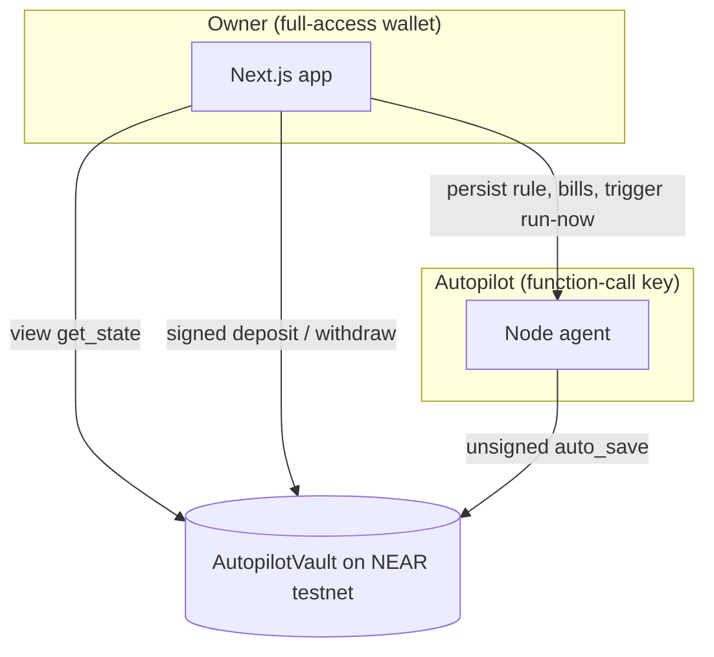

# Vesta

**Money that saves itself — on NEAR testnet.**

Vesta is a hackathon MVP for **autopilot savings**: you connect a wallet, set a daily save rule in dollars, and a background **agent** moves a small amount from your vault’s spending balance into savings **without you signing each transfer**. Withdrawals stay **owner-only**; the agent uses a **function-call access key** scoped to `auto_save` only, so it cannot drain the vault — that restriction is enforced by NEAR, not by trust.

---

## For judges (5-minute demo)

| Step | What to do | What you should see |
|------|------------|---------------------|
| 1 | `npm install` then `npm run demo` | Web on [http://localhost:3000](http://localhost:3000) and the autopilot agent in the same terminal |
| 2 | Open `/` → **Connect wallet** (MyNearWallet, HERE, or Meteor on **testnet**) | After connect, you land in **`/app`** |
| 3 | **Overview** | Vault spending / savings / total, daily save rule in USD, **Run today’s save now** (one-shot agent via API) |
| 4 | **Bills** | Add a recurring bill in USD; see funding progress against savings |
| 5 | **Activity** | Successful autopilot saves (tx links to NEAR Explorer) |
| 6 | **Settings** | Adjust save rule, vault deposit / withdraw (wallet-signed) |

**Credentials:** The demo expects a **deployed vault** and an **agent function-call key** on the machine running the agent (see [Configuration](#configuration)). Example vault id used in repo defaults: `dev-7706-30240.cipher22.testnet`. **Do not commit** `.env`, `agent/.agent-key.json`, or private keys.

**Security proof (optional, ~2 min):** With your own testnet account, run the spike — see [Security verification](#security-verification).

---

## What problem this solves

Most “save money” products either require manual transfers or give a third party full custody. Vesta splits the idea into three pieces:

1. **Vault contract** — Holds NEAR in **spending** vs **savings** buckets, with a per-run cap.
2. **Restricted agent key** — Can call **`auto_save` only** on that vault (NEAR rejects `withdraw` and everything else).
3. **Web app** — Human-friendly USD rules, balances, bills, and activity; only **you** sign deposits and withdrawals.



---

## Features

### Product (web)

- **Landing** — Positioning, how it works, safety story, FAQ ([`web/components/VestaLanding.tsx`](web/components/VestaLanding.tsx)).
- **Overview** — Balances, autopilot status, onboarding when no rule is set, manual “run save now”.
- **Bill reserve** — Track bills in USD and see when savings cover each one.
- **Activity** — Feed of successful saves (skipped/no-balance ticks are not shown to avoid noise).
- **Settings** — Save rule, wallet connection, deposits and withdrawals.

### Agent

- Polls on an interval (default **24h**, `VESTA_INTERVAL_MS`).
- Reads save amount from **`agent/data/rule.json`** (written by the web app) or `VESTA_SAVE_AMOUNT_NEAR`.
- Appends successful (and error) runs to **`agent/data/runs.json`** for the dashboard; **skipped** runs are logged to the terminal only.

### Contract (`AutopilotVault`)

Rust (`near-sdk-rs`), wasm: `contract/target/near/autopilot_vault.wasm`.

| Method | Who can call | Purpose |
|--------|----------------|---------|
| `init(owner, max_per_run)` | Deployer (once) | Set owner and safety cap (yoctoNEAR strings) |
| `deposit()` | Anyone (payable) | Add NEAR to **spending** |
| `auto_save({ amount })` | Caller with gas + balance | Move `amount` from spending → savings, ≤ `maxPerRun` |
| `withdraw({ amount })` | **Owner only** | Move savings back to owner account |
| `get_state()` | View | `spending`, `savings`, `maxPerRun`, `lastRun` |

Access control for withdrawals is in the contract (`predecessor == owner`). The agent key is additionally limited by NEAR **function-call access keys** to method `auto_save` on the vault account only.

---

## Tech stack

| Layer | Stack |
|-------|--------|
| Smart contract | Rust, [cargo-near](https://github.com/near/cargo-near), `near-sdk-rs` |
| Agent | Node.js, `near-api-js`, interval scheduler |
| Web | Next.js (App Router), React, `@near-wallet-selector` (testnet) |
| Monorepo | npm workspaces: `contract`, `agent`, `web` |

**Note:** The original brief mentioned `near-sdk-js`; this repo uses **Rust** because `near-sdk-js` is deprecated and its macOS WASM toolchain is fragile on Apple Silicon. Agent and web remain JavaScript. Details in [SPIKE.md](./SPIKE.md).

---

## Prerequisites

- **Node.js 20+**
- **Rust** + `rustup target add wasm32-unknown-unknown`
- **[cargo-near](https://github.com/near/cargo-near)** — `cargo install cargo-near`
- A **NEAR testnet** account with a little NEAR for deploy/gas (for spike or your own vault)

---

## Quick start

### 1. Install and build the contract

```bash
npm install
npm run build:contract
```

### 2. Prove security on testnet (recommended once)

See [SPIKE.md](./SPIKE.md). Minimal flow:

```bash
export SPIKE_ACCOUNT_ID=your-account.testnet
export SPIKE_PRIVATE_KEY=ed25519:...   # full-access key — never commit this
# optional: export SPIKE_RPC=https://rpc.testnet.near.org
npm run spike:testnet
```

The spike deploys (or reuses) a vault, runs a valid `auto_save`, proves **over-cap `auto_save` fails**, and proves **`withdraw` fails** when signed with the scoped agent key.

To write the agent’s function-call secret for local demos:

```bash
VESTA_WRITE_AGENT_KEY=1 npm run spike:testnet
# → agent/.agent-key.json (gitignored)
```

### 3. Configure agent + web

```bash
cp agent/.env.example agent/.env
cp web/.env.example web/.env.local   # optional
```

Set at least:

- `VESTA_OWNER_ACCOUNT_ID` — account that holds the agent FC key (usually your testnet wallet).
- `VESTA_VAULT_ACCOUNT_ID` — deployed `AutopilotVault` account.
- Agent key via `agent/.agent-key.json` or `VESTA_AGENT_PRIVATE_KEY` in `agent/.env` / shell.

Align the web vault id:

- `NEXT_PUBLIC_VESTA_VAULT_ACCOUNT_ID` in `web/.env.local` (same as `VESTA_VAULT_ACCOUNT_ID`).

### 4. Run

**Web only:**

```bash
npm run dev
```

**Agent only:**

```bash
npm run agent
```

**Judge path (web + agent together):**

```bash
npm run demo
```

Stops both with **Ctrl+C**.

---

## Configuration

### Agent (`agent/.env` or environment)

| Variable | Description |
|----------|-------------|
| `VESTA_OWNER_ACCOUNT_ID` | Owner account id (signer for the FC key) |
| `VESTA_VAULT_ACCOUNT_ID` | Vault contract account id |
| `VESTA_AGENT_PRIVATE_KEY` | Function-call secret (or use `agent/.agent-key.json`) |
| `VESTA_SAVE_AMOUNT_NEAR` | Default save size in NEAR (if no `rule.json`) |
| `VESTA_INTERVAL_MS` | Tick interval (default `86400000` = 24h) |
| `NEAR_RPC_URL` | RPC endpoint (default testnet) |

Persisted rule (written by UI): **`agent/data/rule.json`** (`saveAmountNear`, `updatedAt`, `intervalMs`).

### Web (`web/.env.local`)

| Variable | Description |
|----------|-------------|
| `NEXT_PUBLIC_VESTA_VAULT_ACCOUNT_ID` | Vault for views and transactions |
| `NEXT_PUBLIC_NEAR_RPC_URL` | RPC for wallet + API routes |
| `NEXT_PUBLIC_GITHUB_URL` | Optional footer link on landing page |

Server routes read the agent log at `agent/data/runs.json` (override with `VESTA_RUNS_FILE` if needed). **`POST /api/run-now`** spawns a one-shot save using the same env as the agent.

---

## Project layout

```
vesta/
├── contract/          AutopilotVault (Rust), spike scripts
├── agent/             Scheduled auto_save runner, data/*.json
├── web/               Next.js UI + API routes
├── scripts/demo.mjs   Starts web + agent
├── SPIKE.md           Security spike details
└── README.md          This file
```

### Web API routes (local dev)

| Route | Role |
|-------|------|
| `GET /api/vault-state` | Contract `get_state` |
| `GET /api/runs` | Tail of successful runs for Activity |
| `GET/POST /api/rule` | Read/write save rule file |
| `GET/POST/DELETE /api/bills` | Bill reserve data |
| `GET /api/near-usd` | USD preview for save amounts |
| `GET /api/account-balance` | Connected account balance |
| `POST /api/run-now` | Trigger one agent save |

---

## Security verification

| Check | Where |
|-------|--------|
| Valid `auto_save` moves spending → savings | `npm run spike:testnet` |
| Amount above `maxPerRun` rejected | same |
| Agent FC key cannot call `withdraw` | same (NEAR rejects before contract) |
| Contract rejects non-owner `withdraw` | `contract/src/lib.rs` |

Full write-up: **[SPIKE.md](./SPIKE.md)**.

Local sandbox spike (`npm run spike`) may fail on some machines due to **near-sandbox protocol version** vs current `near-sdk` WASM; **testnet spike is the canonical gate.**

---

## NPM scripts (root)

| Script | Action |
|--------|--------|
| `npm run build:contract` | Build vault WASM |
| `npm run spike` | Sandbox spike (optional) |
| `npm run spike:testnet` | On-chain security proof |
| `npm run agent` | Start autopilot loop |
| `npm run dev` | Start Next.js web |
| `npm run demo` | Web + agent for demos |

---

## Secrets and git

**Never commit:**

- `agent/.env`, `agent/.agent-key.json`
- `agent/data/rule.json`, `runs.json` (local demo state)
- `web/.env.local`
- Any `SPIKE_PRIVATE_KEY` or full-access wallet export

These paths are gitignored where applicable.

---

## Limitations (testnet MVP)

- **Testnet only** — no mainnet deployment in this repo.
- **Single vault / owner** demo configuration — not a multi-tenant production service.
- **USD amounts** are UX estimates via a price feed; on-chain amounts are NEAR (yocto).
- **Agent must run** (or use **Run today’s save now**) for autopilot saves; the chain does not cron by itself.

---


## Further reading

- [NEAR access keys](https://docs.near.org/protocol/access-keys) — function-call keys
- [SPIKE.md](./SPIKE.md) — SDK choice, spike commands, troubleshooting keys
- [DEPLOY.md](./DEPLOY.md) — GitHub push + Vercel

---

**Vesta** — Built for the NEAR Hackathon. *Set one rule. Keep your keys. Let savings run on autopilot.*